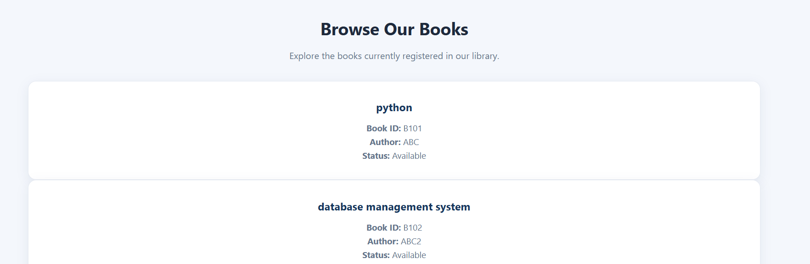
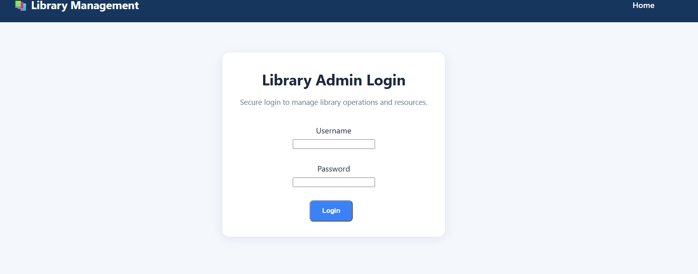
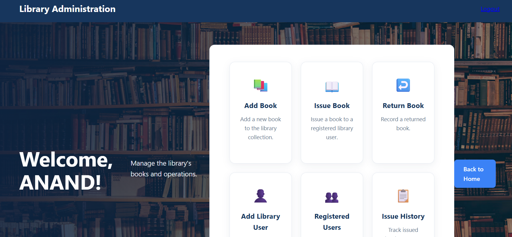

Reader's Alley — Library Management System

A web-based Library Management System built with Django and PostgreSQL to manage books and library operations.

Features

- User login and administrator access
- Add and browse books
- Issue  and return books
- PostgreSQL database integration
- Django-based web interface

## Screenshots

### Home Page


### Explore Books


### Admin Login


### Admin Dashboard


### Add Library Users


### Registered Users


### Issue Book


### Issue and Return History


## Image Credits

- Background image: [Unsplash](https://unsplash.com/)

Technology Stack

- Language: Python
- Framework: Django
- Database: PostgreSQL
- Database connectivity: Django ORM
- Version control: Git and GitHub

Project Structure
```text
project/
├── books/
├── library_project/
├── legacy/
├── manage.py
├── requirements.txt
├── README.md
└── .gitignore
```

Setup Instructions

1. Install Python and PostgreSQL.

2. Clone this repository.

3. Create and activate a Python virtual environment.

4. Install dependencies:
   
   python -m pip install -r requirements.txt

5. Create a local ".env" file using the required environment variables. Do not commit this file.

6. Configure your PostgreSQL database and credentials in ".env".

7. Apply database migrations:
   
   python manage.py migrate

8. Start the development server:
   
   python manage.py runserver

9. Open "http://127.0.0.1:8000/" in your browser.

Security

- Secret keys and database credentials must be stored in environment variables.
- Do not commit ".env", virtual environments, or database credentials.
- "DEBUG=True" should only be used for local development.

Future Improvements

- Improve automated test coverage
- Add user registration and profile management
- Add deployment configuration
- Enhance library reporting and analytics

Author

Developed as a Python and Django project for learning and portfolio development.